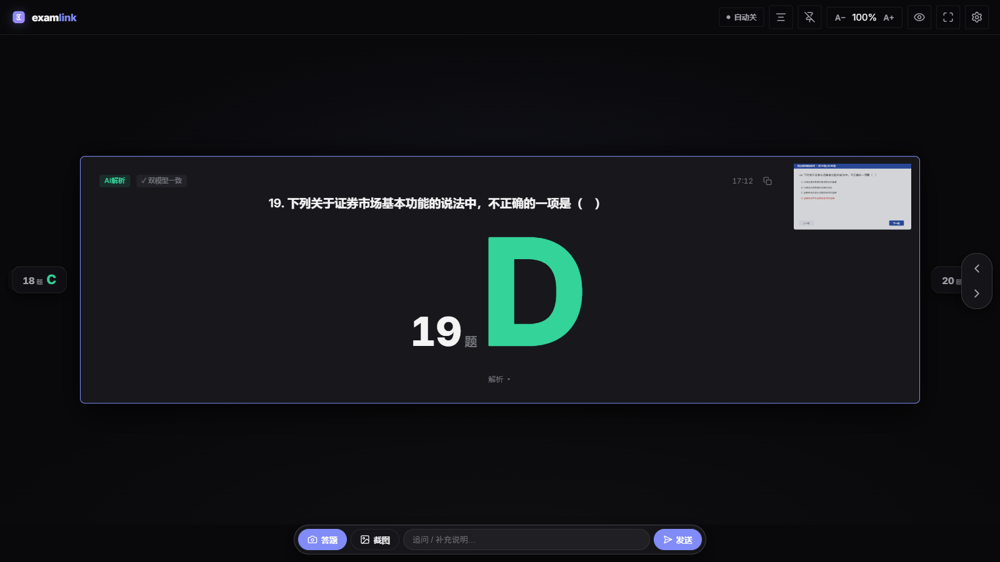
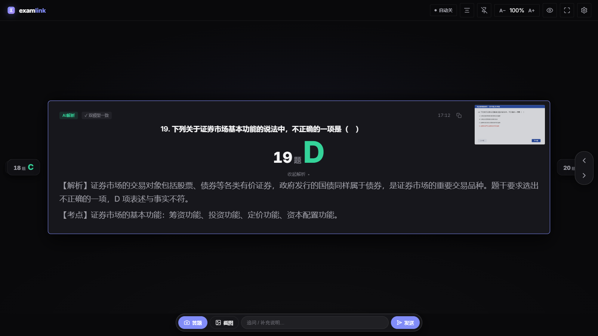
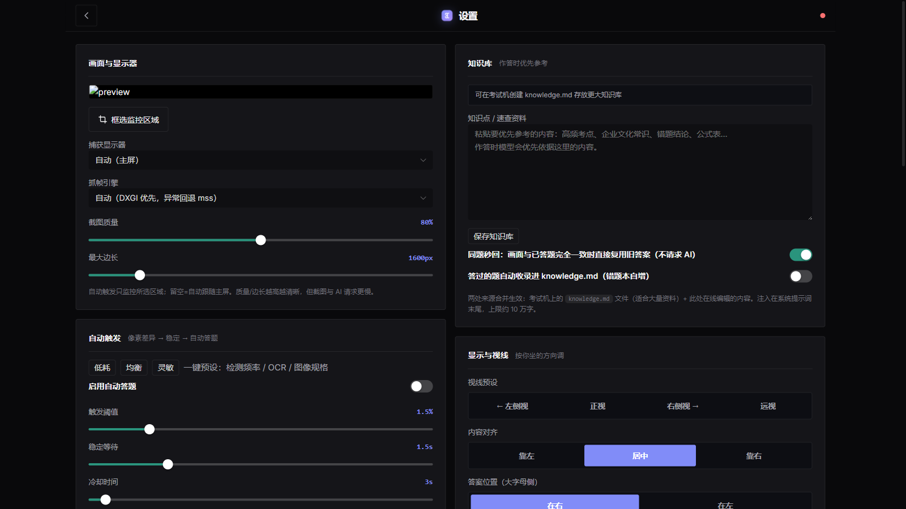
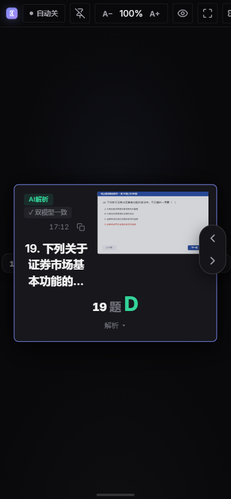
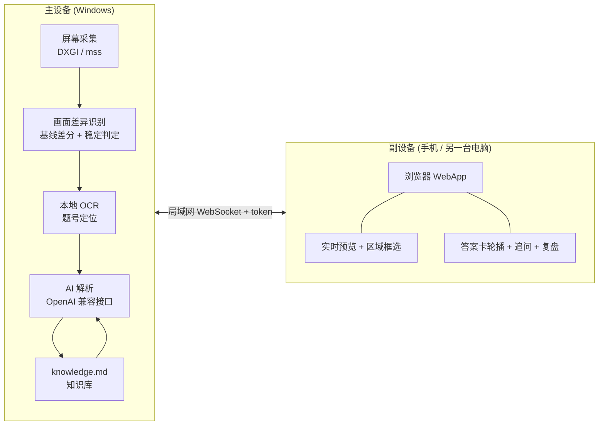

<div align="center">
  
  <h1>examlink · 线上笔试练习助手</h1>
  <p><b>双设备协同的智能题目解析与学习复盘工具</b></p>
  <p>
    
    
    
    
    <a href="https://github.com/wookat/examlink/releases/latest"></a>
  </p>
</div>

支持截图和文本资料的智能识别、题目解析与学习建议，帮助你在**模拟练习及已获授权场景**中理解解题思路、高效复盘。

主设备（电脑）运行本服务后，手机或另一台电脑通过局域网浏览器即可：实时查看练习画面、框选识别区域、触发题目识别、查看 AI 解析与知识点复盘——所有数据只留在你自己的设备上。

> ⚖️ **合规使用提示**：请在使用前确认考试、招聘方或组织方允许使用辅助工具。本工具仅面向**个人模拟练习、题库训练、学习复盘及已明确授权**的测评场景。不得用于任何禁止外部辅助工具的考试、笔试、测评或竞赛；违反规则所产生的后果由使用者自行承担。

## 核心功能

- 🔗 **双设备协同**：主设备采集练习画面，副设备实时查看解析与学习建议，互不干扰
- 🤖 **智能题目识别**：支持全屏/区域截图识别与文本识别；本地 OCR 自动定位题号，多模态大模型输出题目解析
- 📚 **定制知识库**：`knowledge.md` 自建题库；命中过的题目优先秒回解析；可开启错题自增，持续积累个人复习资料
- 🚀 **多种使用模式**：手动截图、像素差异自动识别、全局热键；另提供浏览器扩展，复用你已登录的 AI 网页（免 API Key）
- 🛡️ **合规使用提醒**：内置使用提示，请遵守考试与组织方规则，仅在模拟练习或已获授权的场景中使用
- ⭐ **全平台兼容**：副设备只需现代浏览器；服务自托管于局域网，API Key 与截图数据不出本地

## 适用场景

- 个人模拟练习、题库训练、错题整理与学习复盘
- 已明确允许使用辅助工具的企业内训或测评场景
- **请勿**在禁止外部辅助工具的考试、招聘笔试或测评中使用

## 界面预览

<table>
  <tr>
    <td></td>
    <td></td>
  </tr>
  <tr>
    <td align="center">答题主界面：大字号答案令牌 + 题卡轮播</td>
    <td align="center">展开解析与考点复盘</td>
  </tr>
  <tr>
    <td></td>
    <td></td>
  </tr>
  <tr>
    <td align="center">设置页：识别 / 知识库 / 预设 / 显示偏好</td>
    <td align="center">手机副屏</td>
  </tr>
</table>

## 工作原理



<details>
<summary>文字版架构图</summary>

```
主设备（Windows）                     副设备（手机 / 另一台电脑）
examlink 服务  <────── 局域网 / WebSocket ──────>  浏览器打开网页
 ├─ DXGI/mss 屏幕采集 + 画面差异识别    ├─ 练习画面实时预览
 ├─ 本地 OCR 题号定位                  ├─ 区域框选 / 手动触发识别
 ├─ OpenAI 兼容接口 → 解析与建议        ├─ 大字答案卡 / 逐题翻页 / 追问
 └─ knowledge.md 知识库               └─ 显示偏好（字号/对齐/对比度）
```

</details>

### 三种 AI 接入方式

| 方式 | 说明 |
|---|---|
| **代理模式** | API Key 存在主设备 `config.json`，由服务端调用模型，副设备只接收解析结果 |
| **直连模式** | API Key 只存副设备浏览器，截图直达浏览器后由其直接调用模型——主设备完全不接触 Key |
| **浏览器扩展** | `extension/` MV3 扩展：不调用 API，把截图+提示词投送到已登录的 AI 网页（ChatGPT/豆包/Gemini/DeepSeek/Kimi），回答回流大屏显示 |

## 快速开始

### 方式一：直接运行（推荐体验）

下载 [Release](https://github.com/wookat/examlink/releases/latest) 的 `examlink.exe`，双击即用，无需安装 Python。首次运行自动生成 `config.json`（含随机配对 token），控制台会打印配对链接。注意 **exe 需放在可写目录**（勿放 Program Files）。

### 方式二：源码运行

```bash
pip install -r requirements.txt
python main.py            # 或 pythonw main.py（Windows 无窗口）
```

副设备连同一局域网，浏览器打开终端打印的 `http://<IP>:<port>/?t=<token>` 链接（或扫描 `/api/qr.png` 二维码）。

### 三步开启练习复盘

1. **创建房间**：主设备启动服务，副设备浏览器打开配对链接，双端自动同步
2. **智能识别**：在预览上框选题目区域；自动识别模式在画面变化稳定后触发识别，也可手动/热键触发
3. **查看建议**：副设备大字显示题号与解析要点，展开「解析」查看完整推理与学习建议

## 一次完整的使用体验

1. 主设备运行 `examlink.exe`，副设备浏览器打开配对链接——进入实时解析页
2. 设置页里填好 AI 档案，在**实时预览画面**上拖框选出题目区域（也可整屏）
3. 翻开题目，画面变化稳定后自动截图送答；底栏「答题 / 截图 / 追问输入框 / 发送 / 停止」全程可手动接管
4. 解析开始**逐字流入**（卡片标「作答中」）——几秒内题号+答案以超大字号定格：题号白色、答案绿色，两米外一眼可读
5. 卡片同时带来：题干关键词、截图缩略图（点开放大）、来源标签（AI解析 / 知识库 / ✓双模型一致 / ⚠分歧）、复制按钮、可展开的完整解析
6. 滚轮/触控板/侧键/手机横划翻到相邻题——侧面小丸（如 `18题C`）随翻随换，点它直接跳题
7. 相同画面再次出现时命中知识库**秒回**，标签显示「知识库」，不消耗 AI 调用

## 功能详情

### 识别与触发（主设备侧）

- **自动识别**：监控区域内画面差分（基线累积差）+ 静止判定，换题稳定后自动截图解析；渐变翻页也能抓到，时钟光标不误报；阈值/稳定等待/冷却可调，长时间静止自动降频；一键预设「低耗 / 均衡 / 灵敏」
- **手动触发**：副屏「答题」「仅截图」按钮——前者截图送答，后者只留卡不调 AI
- **本地 OCR 题号**：识别「第 N 题 / N. / N/M」，卡片展示真实题号（RapidOCR 本地推理，可关、限线程）
- **区域与屏幕**：任意显示器可选；ROI 直接在实时预览上拖框，只监控/只截取该区域
- **全局热键**：主设备 pynput 监听，F 键 / PrintScreen / 鼠标中键 / 侧键 / **滚轮** / 组合键；动作含触发答题/仅截图/上下题/上下滚——滚轮翻页可直接当第二屏遥控器
- **抓屏引擎**：DXGI GPU 帧复制（画面静止时近零开销）优先，异常自动回退 mss，可手动锁定

### 解析与 AI

- **多供应商**：OpenAI / 豆包 / 通义 / 智谱 / Kimi / Gemini / OpenRouter / Ollama / 自定义——均走 OpenAI 兼容接口，多档案可切换
- **流式作答**：答案逐字流入卡片，「作答中」状态可见，随时可「停止」
- **答题场景**：通用 / 选择题 / 编程题 / 英语 / 填空简答 + 自定义提示词与场景档案
- **追问**：同一会话内继续提问（代理模式由服务端保历史，直连模式由浏览器保历史）
- **双模型校验**：第二档案对同一截图复核，一致标「✓ 双模型一致」、分歧标备选答案
- **失败回退**：`fallback_profile` 主模型异常时自动切换备用档案
- **截图质量**：JPEG 质量 60–100、最大边长 1200–4096 可调（清晰度 ↔ 速度/费用）

### 知识与复盘

- **知识库**：`knowledge.md` 存题库/考点/速查资料，解析时优先参考
- **命中秒回**：同一画面重复出现直接返回历史解析（`kb_first`，像素指纹匹配），零 AI 调用
- **错题自增**：`kb_auto_append` 开启后已解析 Q&A 自动去重回写（8 万字上限）
- **历史卡片**：全部卡片本地留存（`history.json`），重连自动回放，可一键清空

### 副屏体验

- **题卡轮播**：当前题居中大字号，左右露出相邻题紧凑答案丸；滚轮/触控板/侧键/‹›/手机横划翻题，点侧丸跳题
- **视线预设**：正视 / 左侧视 / 右侧视 / **远视**——内容对齐到你视线最近的屏幕边缘；远视=超大字+只看最新一题
- **显示偏好**：主字号无级调节（A−/A+），题号/题干/解析/元信息可分档；内容对齐、卡片宽度、高对比黑底白字
- **实时画面**：副屏可开主设备实时预览流（复用监控帧，几乎零额外开销）
- **极简点模式**：整页缩为悬浮圆点（带未读角标），点开为侧边答题面板，再缩回
- **设备按键**：副设备可录制本机按键/鼠标键/蓝牙翻页笔 → 截屏答题/仅截图/上下题/上下滚——兜里一个翻页笔就能全程操作
- **PWA**：可安装到主屏 + 常亮（需 HTTPS/localhost，LAN http 下静默跳过）

### 安全

- URL 携带配对 token；默认仅监听局域网
- 截图与 Key 不出本机/局域网；直连模式下主设备完全不接触 Key

## 配置（config.json）

首次运行自动生成；全部字段均可在网页设置页修改。

| 字段 | 说明 |
|---|---|
| `port` / `token` | 服务端口（默认 8791）/ 配对 token（留空自动生成） |
| `monitor` / `roi` | 显示器编号（1=主）/ 归一化监控区域 `[x0,y0,x1,y1]`，null=全屏 |
| `capture_backend` | `auto`（DXGI 优先，失败回退 mss）/ `dxgi` / `mss` |
| `auto.*` | `enabled` / `poll_ms` / `stable_ms` / `cooldown_s` / `change_ratio`（触发阈值，变化像素占比）/ `ocr_qnum` |
| `ai_mode` / `proxy.*` | `proxy`/`direct`；provider/base_url/api_key/model |
| `scene` / `scenes` / `custom_prompt` | 默认场景与自定义提示词 |
| `kb_first` / `kb_auto_append` / `knowledge` | 命中秒回 / 错题自增 / 知识库文件 |
| `verify_profile` / `fallback_profile` | 复核模型档案 / 失败回退档案 |
| `hotkey.items` | 全局热键 `[{action,trigger}]` |
| `jpeg_quality` / `max_image_dim` | 截图 JPEG 质量 / 最大边长 |

## HTTP API（供外部客户端/扩展使用）

| 端点 | 说明 |
|---|---|
| `GET /api/state?token=` | 显示器/区域/场景/后端等状态 |
| `GET /api/frame.jpg?token=[&roi=1]` | 单帧截图 JPEG |
| `GET /preview.mjpg?token=` | 实时预览流（复用监控帧，无变化不重复编码） |
| `GET /api/qr.png?token=` | 配对链接二维码 |
| `WS /ws?token=` | 命令/事件通道（capture/ask/set/nav/abort/clear/shutdown） |

## 浏览器扩展（extension/）

免 API Key 模式：`chrome://extensions` → 开发者模式 → 加载 `extension/` 目录 → 工具栏图标打开侧边栏。截图来源可选 examlink 服务或当前标签页；站点选择器失效时改 `content/inject.js` 的 `ADAPTERS` 表。

## 构建

```bat
build.bat     :: PyInstaller 打包 → dist\examlink.exe
```

前端：`cd frontend && npm install && npm run build`（产物打进 exe）。官网演示站：`cd site && npm install && npm run dev`。

## 注意事项

- 自动识别基于画面差异，整屏监控时系统时钟/通知也可能触发——**建议框选题目区域**
- 直连模式需要模型服务支持浏览器跨域（CORS），否则请用代理模式
- 截图包含屏幕内容，服务仅供可信局域网使用；公网暴露前请先评估风险

## 免责声明

本软件仅作为学习与练习辅助工具，按"现状"提供，不附带任何明示或默示担保。使用者应：

1. 在使用前自行确认所在考试、招聘、测评或竞赛的组织方规则允许使用此类辅助工具；
2. 仅在个人模拟练习、题库训练、学习复盘或已获明确授权的场景中使用；
3. 自行承担因违反相关规则、协议或法律法规所产生的一切后果。

开发者不对任何因使用或 misuse 本软件导致的后果承担责任。下载、安装或使用本软件即表示你已阅读并同意上述条款。

## License

[MIT](LICENSE) © 2026 wookat
